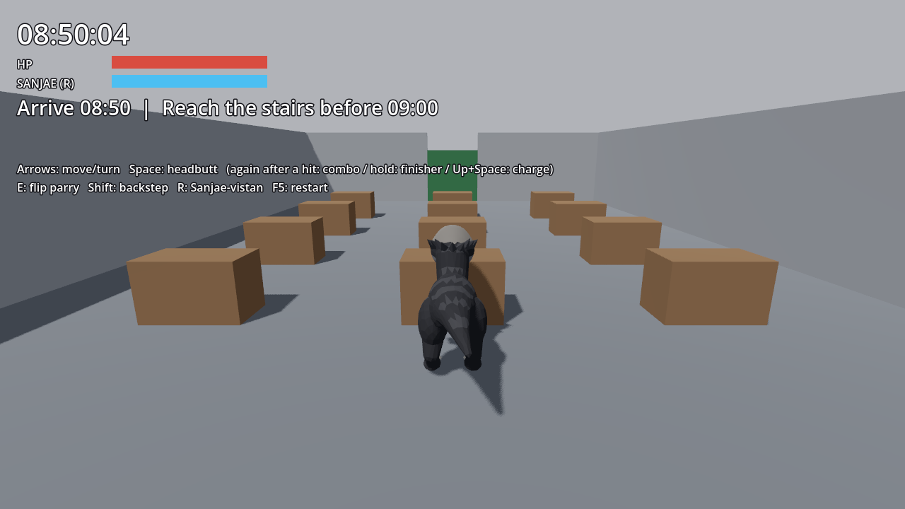

# Ram

쉬고 싶은 박치기 공룡 Ram 이 사직서를 내러 회사 9층 인사팀까지 머리로 깨부수며 올라가는 3D 근접 격투 로그라이크.
진행 방식은 하데스, 싸우는 손맛은 시푸에서 가져온다. 한 판은 출근 시각부터 오전 9시까지.

- **스토리:** AI 에 밀려 지하 1층으로 쫓겨난 개발자 Ram. 사원증으로 엘리베이터도 못 타서 계단으로 층마다 깨부수며 올라간다. 잡히면 끌려가 일하고, 다음 날 아침 다시 출근.
- **성장:** 일해서 번 돈으로 집을 꾸며 더 일찍 일어나고(시간), 지하 동료들이 몸을 사이버웨어로 개조해 준다(능력치).
- **특징:** 시간 감속 능력 '산재비스탄', 조력자 4인과 합체 필살기(두루치기·양치기·메치기·날치기).

- 설계 결정: [`docs/design.md`](docs/design.md) (원본 문서: https://claude.ai/artifact/84osqWgQkDQugsrKgKLPxC)
- 엔진: Godot 4 · 플랫폼: Windows PC
- 아트: 로우폴리 + 단색 면 + 약한 명암 (주인공 돌머리만 매끈)

## 폴더

| 경로 | 내용 |
|---|---|
| `tools/blender/build_dino.py` | 주인공 모델을 만드는 Blender 파이썬 스크립트 |
| `tools/blender/rig_dino.py` | 모델에 뼈대·가중치·기본 동작을 넣는 스크립트 |
| `tools/blender/preview_anims.py` | 동작마다 미리보기 GIF 를 만드는 스크립트 |
| `tools/blender/build_helpers.py` | 조력자 4인 첫 디자인 모델 스크립트 |
| `tools/blender/build_commute.py` | 출근길 장면(돌 이글루 마을 → 9층 회사). `export` 로 게임용 모델, `start`·`arrive` 로 확인용 렌더 |
| `tools/blender/build_home.py` | 집 안 장면(돌 이글루 방). `export` 로 게임용 모델, `stone`·`warm`·`cold` 로 확인용 렌더 |
| `assets/environments/` | 장면 모델: `commute/commute.glb` 출근길, `home/home.glb` 집 안 |
| `project.godot`, `game/` | Godot 4.7 프로젝트 (저장소 루트가 프로젝트 루트, `docs/`·`tools/` 는 `.gdignore` 로 제외) |
| `assets/characters/ram/` | 주인공 모델. `dino.*` 정지 모델, `ram_rigged.*` 뼈대·동작 포함 (Godot 에는 `ram_rigged.glb`) |
| `assets/characters/helpers/` | 조력자 모델 (`crane`·`sheep`·`catfish`·`flyfish` .glb/.blend) |
| `docs/design.md` | 확정한 설계 결정 (스토리·하루의 흐름과 성장·건물·조작·카메라·디자인 규칙·산재비스탄·빌드와 조력자) |
| `docs/renders/` | 렌더 사진: `latest/` 최신 · `checkpoint_01/` 첫 모델 · `helpers/` 조력자 · `explorations/` 비교 시안 |
| `.claude/skills/ram-motion/` | Claude Code 스킬: Ram 동작을 만들고 고치는 순서와 함정. `scripts/gif_sheet.py` 는 동작 GIF 를 프레임 시트 한 장으로 펼친다 |

## Godot 에서 실행하기

Windows 에서는 `tools/setup_windows.ps1` 내용을 PowerShell 에 붙여 넣으면 Git·Godot 4.7.2 설치(바탕화면\Godot), 저장소 받기(바탕화면\home\ram), 에디터 열기까지 한 번에 된다. 손으로 하려면:

1. Godot **4.7** (표준판, .NET 아님)을 받는다: https://godotengine.org/download
2. Godot 를 열고 **Import** → 이 저장소 폴더의 `project.godot` 를 고른다. 처음 열 때 모델을 가져오느라 잠깐 걸린다.
3. **F5** (또는 오른쪽 위 ▶) 로 실행한다. 시험용 층이 뜬다. 에디터의 Game 탭 안에 뜨면 화면을 한 번 클릭해야 키가 먹는다.

에디터 없이 게임만 띄우려면 저장소 폴더에서 `Godot_v4.7.2-stable_win64.exe --path .` (다른 세션이 올린 것까지 보려면 먼저 `git pull`).

| 키 | 동작 |
|---|---|
| 방향키 위·아래 | 앞뒤 이동 |
| 방향키 좌·우 | 몸 돌리기 (카메라가 살짝 늦게 같이 돈다) |
| Space | 박치기. 늘 같은 순서의 4타 콤보로 이어진다: 옆구리 들이받기(왼쪽) → 후려치기(오른쪽) → 올려치기(위) → 일어섰다 내리찍기(피니시). 맞으면 히트스톱과 화면 흔들림 |
| Space (이어서) | 콤보: 회복을 끊고 다음 타로 이음. 1~3타는 대상을 조금만 밀고, 피니시가 날린다. 집기는 가벼운 타 셋 + 피니시에서 부서짐 |
| Space 길게 | 피니시(일어섰다 내리찍기) |
| 위 + Space | 돌진 공격 |
| E | 공중제비 꼬리 패링 (카메라는 돌지 않음) |
| Shift | 백스텝 |
| R | 산재비스탄: 3초 동안 주변과 9시 시계가 느려진다. 쓸 때마다 체력 5 감소 |
| F5 (게임 중) | 판 다시 시작 |

동작 중에 누른 Space 는 0.35초, Shift·E 는 0.15초 기억했다가 할 수 있게 되는 순간 나간다. 박치기의 회복 동작은 맞는 순간 3프레임 뒤부터 Shift 로, 0.25초 뒤부터 E 로 끊을 수 있다. 방향키로는 피니시·돌진만 0.4초 뒤에 끊긴다(연타 중간 타는 다음 타나 회피로만 빠져나간다). R 은 동작 중에도 켜진다.

8:50 에 도착해 9:00 (실제 5분) 전에 앞쪽 초록 계단 문에 닿으면 성공, 못 가면 '끌려감'.



### 출근길 시험 장면

집(돌 이글루 방)의 알을 깨고 나와 회사 정문까지 가는 장면. 알 깨기 2.2초, 그 뒤 곧장 달리면 10.5초쯤(집 안 4m + 바깥 길 31m, 3.5m/s). 저장소 폴더에서:

`Godot_v4.7.2-stable_win64.exe --path . res://game/commute/commute.tscn`

| 키 | 동작 |
|---|---|
| 방향키 | 화면 기준으로 자유 이동 (위 = 화면 안쪽, 바깥에서는 회사 쪽) |
| Space | 박치기 (시험용 층과 같다: 번갈아 4종·콤보·길게 눌러 피니시). 방향키와 함께면 돌진 |
| E | 공중제비 꼬리 패링 |
| Shift | 방향키와 함께면 그 방향으로 대시(0.34초에 1.75m, 달리다 쓰면 속도를 이어받는다. 끝나면 Space·E·방향키로 바로 이어짐), 혼자면 백스텝 |
| R | 산재비스탄 |
| F5 | 다시 시작 |

Ram 은 시험용 층과 같은 플레이어(`game/player/player.gd`)를 자유 이동(`free_move`)으로 켜서 쓴다. 시작하면 Ram 이 통째로 들어가는 큰 알(높이 2.6m)이 세 번 흔들리다 금이 가고, Ram 이 박치기로 깨고 튀어나와 알 옆에 내려선다. 위쪽은 큼직한 조각 여섯으로 갈라진다. 아래쪽 껍질은 잠자리로 남고 조각은 바닥에 떨어졌다가 사라진다. 집 안에서는 방 안을 자유롭게 돌아다닌다(벽·알 껍질에 막힌다). 카메라는 한 자리에 서서 Ram 쪽으로 고개만 돌린다. 현관 굴로 나가면 화면이 잠깐 어두워졌다가 집 문 앞으로 이어진다. 바깥에서는 길 영역(집 문 앞 샛길 · 마을 돌길 · 회사 광장 가운데 보도) 안에서 자유롭게 움직이고, 경계석 밖과 길 위의 직원은 지나가지 못한다. 바깥 카메라는 주택가에서는 등 뒤에 가깝고 낮게 붙어 있다가, 주택가와 회사 광장의 경계부터 위로 올라가며 크게 줌 아웃한다. 정문에 닿았을 때는 건물 꼭대기 위로 하늘까지 보인다(높이 16m·뒤 30m). 정문에 닿으면 도착. 점검: `godot --headless --path . --fixed-fps 120 --script tools/godot/commute_test.gd` → `COMMUTE TEST: PASS`

플레이 녹화: [`docs/renders/latest/godot_test_floor.mp4`](docs/renders/latest/godot_test_floor.mp4), 박치기 4종·공중제비 패링: [`docs/renders/latest/godot_attacks_parry.mp4`](docs/renders/latest/godot_attacks_parry.mp4), 콤보·파편·소리: [`docs/renders/latest/godot_combo_fx.mp4`](docs/renders/latest/godot_combo_fx.mp4)

| 파일 | 내용 |
|---|---|
| `game/main.gd` | 시험용 층(방·책상·계단 문·HUD)과 판 시작·끝 |
| `game/player/player.gd` | Ram 조작, 동작 재생, root motion(대시·백스텝·패링), 박치기 판정, 산재비스탄 |
| `game/camera/follow_camera.gd` | 등 뒤에서 살짝 늦게 따라 도는 카메라 (벽에 막히면 벽 안쪽으로 당김) |
| `game/hud/work_clock.gd` | 9시 마감 시계 (2배속, 산재비스탄 중 같이 느려짐) |
| `game/props/breakable.gd` | 박치기로 날아가는 집기 |
| `game/player/foot_grounder.gd` | 발 IK: 발이 바닥 아래로 묻히려 할 때만 다리를 접음 |
| `game/fx/` | 합성 효과음(충돌음·바람 소리)과 맞는 순간의 파편 |
| `tools/godot/measure_feet.gd` | 동작별 발 속도·발목 높이 측정 (발 미끄러짐 맞춤용) |
| `tools/godot/setup_input.gd` | 키 배치를 `project.godot` 에 써 넣는 스크립트 |
| `tools/godot/smoke_test.gd` | 헤드리스 자동 점검: `godot --headless --path . --fixed-fps 120 --script tools/godot/smoke_test.gd` |
| `tools/godot/capture_frame.gd` | 화면 확인: 창을 몇 초 띄워 N 프레임 뒤 화면을 PNG 로 저장. `godot --path . --resolution 960x540 --script tools/godot/capture_frame.gd -- out.png [프레임]` |
| `game/commute/commute.gd` | 집·출근길 시험 장면: 알 깨기, 자유 이동과 걸을 수 있는 영역, 광장 경계부터 물러나는 카메라, 도착 판정 |
| `tools/godot/commute_test.gd` | 집·출근길 헤드리스 자동 점검 |
| `tools/blender/build_home.py` · `build_commute.py` | 집(돌 이글루 방 + 알)과 출근길(마을·광장·회사) 장면을 만들고 게임용 GLB 로 내보냄 |
| `docs/audit/2026-11-20/` | 냉정한 평가 기록: 기준·점수·살아남은 지적(README), 평가자 보고서, 증거 화면, 측정 스크립트 |
| `tools/godot/compare_models.gd` | 디자인 전·후 비교: GLB 여러 개를 같은 크기·조명으로 3/4 앞·옆·뒤·게임 카메라·3/4 뒤·얼굴 6각도 찍어 한 장으로. `godot --path . --resolution 420x420 --script tools/godot/compare_models.gd -- out.png 이름=a.glb 이름=b.glb@0,0.03,0.18 [--game]` |

## 주인공 모델 다시 만들기

Blender 없이 파이썬 모듈 `bpy`로 돌린다 (bpy 5.2 이상은 Python 3.13 필요. 회사 PC 는 5.3).

```bash
python -m venv .venv
.venv/bin/pip install bpy          # Windows: .venv\Scripts\pip install bpy
.venv/bin/python tools/blender/build_dino.py out
```

`out/`에 `dino.blend`, `dino.glb`, 렌더 사진(`render_*.png`)이 생긴다.
설치된 Blender로 돌려도 된다: `blender -b -P tools/blender/build_dino.py -- out`

### 뼈대·동작 넣기

```bash
.venv/bin/python tools/blender/rig_dino.py out/dino.blend out
```

`out/ram_rigged.glb`에 뼈대 18개와 동작 15개가 들어간다.

| 동작 | 내용 |
|---|---|
| `Idle-loop` · `Walk-loop` · `Run-loop` | 대기 · 걷기 · 달리기 |
| `Attack_RearSlam` | 뒷다리로 일어섰다가 떨어지며 내리찍기 (큰뿔양) |
| `Attack_LowCharge` | 몸을 낮추고 달려들어 정면으로 받기 |
| `Attack_FlankButt` | 몸을 틀었다가 돌머리 옆면으로 후려치기 |
| `Attack_Shove` | 머리를 댄 채 세 번 밀어붙이기 |
| `Attack_Hook` | 콤보 2타: 왼쪽 위로 들었다가 오른쪽 아래로 후려치기 (2026-11-21 다시 만듦) |
| `Attack_Uppercut` | 콤보 3타: 깊이 웅크렸다가 두 다리로 차오르며 올려치기, 몸이 살짝 뜸 (2026-11-21 다시 만듦) |
| `Attack_Slam` | 첫 버전 박치기 (게임에서 쓰지 않음) |
| `Parry_Tail` | 앞으로 공중제비를 돌며 꼬리로 앞을 내리침 |
| `Backstep` | 앞다리로 밀며 뒤로 0.65m |
| `Dash` | 뒷다리로 차며 앞으로 1.0m |
| `Dash_Left` · `Dash_Right` | 옆으로 0.8m |

대시·백스텝·패링은 `root` 뼈가 실제로 움직인다(Godot 에서 root motion 으로 쓸 수 있다).
이름 끝의 `-loop`는 Godot가 반복 재생으로 가져오라는 표시다.

동작 미리보기 GIF (Pillow 필요):

```bash
.venv/bin/pip install pillow
.venv/bin/python tools/blender/preview_anims.py out/ram_rigged.blend out
```

최신 GIF: `docs/renders/latest/anim_*.gif` (동작마다 하나)

### 색 바꾸기

스크립트 맨 위 `PALETTE`만 바꾸면 된다. `accent` 슬롯(등 줄무늬·돌기)은 빌드에 따라 게임에서 바꿀 색이다.

## 조력자 (빌드마다 하나, 합체 필살기)

| 빌드 | 조력자 | 합체 필살기 | 성격 |
|---|---|---|---|
| 1 | 두루미 | 두루치기 | 공중·낙하 |
| 2 | 양 | 양치기 | 방어·패링 |
| 3 | 메기 | 메치기 | 잡기·던지기 |
| 4 | 날치 | 날치기 | 속도·대시 |

첫 디자인: `.venv/bin/python tools/blender/build_helpers.py out` → `docs/renders/helpers/lineup.png`(Ram 과 나란히)

## 작업 기록

| 단계 | 내용 |
|---|---|
| 체크포인트 1 | 첫 주인공 모델: 돌머리 한 덩어리, 반달 동심원 눈, 짧은 주둥이와 입선, 차콜 바탕 + 빌드 색 슬롯 (`docs/renders/checkpoint_01/`) |
| 비율 | 주둥이 가시 제거, 머리 쪽 1.3배(`HEAD_SCALE`), 기둥형 다리 + 가는 발목 + 넓은 발(`LEG_X`), 팔 굵게, 꼬리 짧고 굵게 |
| 돌머리 | 테두리부터 위로 좁아지게, 꼭대기 낮춤, 체크포인트 1의 톱니 경계 무늬 유지(`PAINT_DOME_*`), 잿빛 |
| 뼈대·동작 | 뼈 18개, 동작 15개 (`ram_rigged.glb`, 처음에는 11개), 동작 GIF |
| 조력자 | 두루미·양·메기·날치 첫 디자인 |
| 기획 | 스토리 'Ram은 쉬고 싶다'(회사 편), 하루의 흐름과 두 갈래 성장, 시계 2배속, 9층 인사팀 따귀 이벤트, 산재비스탄, 사이버웨어 개조 (`docs/design.md`) |
| Godot | 4.7 프로젝트, 시험용 층에서 이동·박치기·패링·백스텝·산재비스탄·9시 시계, 헤드리스 자동 점검 |
| 모션·전투 | 걷기·달리기 새로 짬, 박치기 4종 번갈아 쓰기, 공중제비 패링, 히트스톱·화면 흔들림, 콤보 1차 초안, 발 IK, 합성 효과음·파편 (`docs/design.md` '모션·전투 다듬기') |
| Windows PC | 바탕화면\home\ram 에 저장소, Godot 4.7.2 세팅. 카메라가 벽에 막히면 벽 안쪽으로 당김(F5 첫 화면이 뒷벽 바깥면만 보이던 것), 화면 캡처 도구, 줄 끝 LF 고정(`.gitattributes`) |
| 출근길 | 돌 이글루 마을에서 9층 회사까지 곧은 길 장면(Blender 스크립트), 직접 달려 보는 시험 장면과 자동 점검 |
| 집·알 | 집의 큰 알을 깨고 나오며 시작, 집 안·길 영역 자유 이동, 박치기·패링·대시·백스텝, 달리기 3.5m/s |
| 평가 | 독립 평가자 넷 + 반박 검증: 100점 중 약 35점 (`docs/audit/2026-11-20/`) |
| 조작감 1차 | 동작 중 입력 기억(0.2초), 박치기 회복을 Shift·E·방향키로 끊기, 대시를 달리기보다 빠르게 (`docs/design.md` '모션·전투 다듬기') |
| 콤보 다시 짜기 | 가벼운 타는 조금만 밀고 피니시만 날림(4타가 다 맞게), 이어지는 타를 빠르게, 순서 고정 4타, 후려치기·올려치기 동작 다시 만듦, 피니시 카메라 (`docs/design.md` '콤보 다시 짜기') |
| 뒷모습 | 목을 세워 머리를 0.18m 올림(뒤에서 머리가 어깨에 가리던 것), 돌머리만 매끈하게, 돌기를 뒤쪽으로 모음, 배 색을 몸통 아래로만, 눈 판 묻기, 등 줄무늬 어둡게(0.30). 나란히 비교 도구 (`docs/design.md` '주인공 디자인 규칙') |

자세한 변경은 `git log` 에, 세션마다 정한 것과 만든 것은 [`docs/sessions/`](docs/sessions/) 에 있다.
